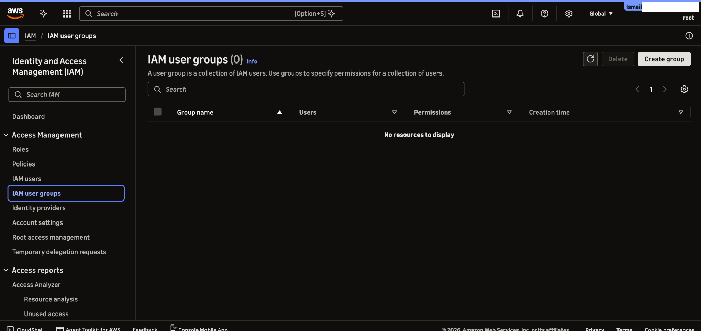
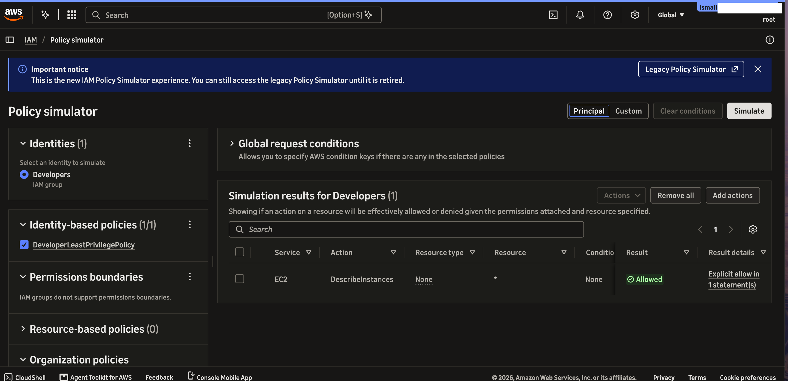
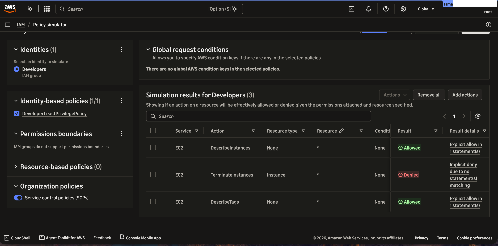

# AWS IAM and Least Privilege Project

## Phase 1: AWS Account Security

### Objective

Secure my AWS account before implementing IAM security controls.

### Security Controls Implemented

| Security Control | Status |
|---|---| 
| AWS account access verified | Completed |
| Root account MFA | Completed |
| Monthly AWS budget | Completed |
| Billing notifications | Completed |

### Root Account MFA

Enabled Multi-Factor Authentication (MFA) on my AWS root account to provide an additional layer of protection against unauthorised access.

MFA requires an additional authentication factor alongside the account password, making it more difficult for unauthorised users to access the account.

### AWS Monthly Budget

Created a monthly AWS cost budget to monitor cloud expenditure and track spending against a defined budget limit.

Configured spending thresholds to help monitor actual and forecasted costs and identify unexpected increases in expenditure.

### Billing Notifications

Configured AWS billing notifications to receive alerts when cloud spending reaches specified thresholds.

These notifications help monitor AWS expenditure and provide early warnings of unexpected increases in cloud costs.

### Security Considerations

- Root account access should be restricted and used only when necessary.
- MFA should be enabled on privileged accounts.
- Billing notifications help identify unexpected expenditure.
- AWS Budget alerts do not automatically stop AWS services or prevent additional charges.
- AWS account spending should be monitored regularly.

### Evidence

**Root Account MFA**

**MFA Device Assigned**

**MFA Verification**

**AWS Monthly Budget**

**Billing Notifications**

### Lessons Learned

Through this phase, I learned how to secure an AWS root account using MFA, configure monthly AWS budgets and set up billing notifications.

I also learned the importance of protecting privileged accounts and monitoring cloud expenditure to help manage unexpected costs.

---
## Phase 2: AWS IAM Users and Groups Creation

### Objective

The aim of this phase was to create IAM users and groups in AWS and organise access based on different job roles.

### Step 1: Check Existing IAM Users and Groups

I first checked my AWS account to see whether any IAM users or groups already existed.

**Findings:**
- No existing IAM users were found.
- No existing IAM groups were found.

This gave me a clean starting point for creating my IAM environment.

**Evidence:**

### Step 2: Create IAM Groups

I created two IAM groups for different job roles.

| Group name | Purpose |
|---|---|
| Developers | For users carrying out development tasks. |
| SecurityAuditors | For users carrying out security auditing tasks. |

Creating groups makes it easier to manage permissions for different users.

**Evidence:**

## Phase 3: Custom IAM Policies and Permission Testing

### Stage 4: Create Custom IAM Policies

**Objective:** Create custom IAM policies that provide the correct permissions to the Developers and SecurityAuditors groups.

I created two custom IAM policies:

- `DeveloperLeastPrivilegePolicy`
- `SecurityAuditorReadOnlyPolicy`

These policies were designed to give each group the permissions it needs while avoiding unnecessary access.

#### Evidence: Custom IAM Policy Creation

**Screenshot 1: SecurityAuditors custom policy**

**Screenshot 2: Developers custom policy**

### Stage 5: Assign Permissions to IAM Groups

After creating the policies, I attached them to the appropriate IAM groups.

| IAM Group | Attached Policy |
|---|---|
| Developers | `DeveloperLeastPrivilegePolicy` |
| SecurityAuditors | `SecurityAuditorReadOnlyPolicy` |

This allows permissions to be managed through IAM groups instead of assigning them individually to each user.

#### Evidence: Policy Assignment

**Screenshot 3: SecurityAuditors group permissions**

**Screenshot 4: Developers group permissions**

### Stage 6: Test SecurityAuditors Permissions

I used the AWS IAM Policy Simulator to test the permissions assigned to the SecurityAuditors group.

The purpose was to confirm that the group could view AWS configuration information but could not perform destructive actions such as terminating EC2 instances or deleting S3 objects.

#### Test 1: View EC2 Instances

- **Action:** `ec2:DescribeInstances`
- **Expected result:** Allowed
- **Actual result:** Allowed

The group was able to view EC2 instance information.

#### Test 2: Terminate EC2 Instances

- **Action:** `ec2:TerminateInstances`
- **Expected result:** Denied
- **Actual result:** Denied

The group was not allowed to terminate EC2 instances.

#### Test 3: View EC2 Tags

- **Action:** `ec2:DescribeTags`
- **Expected result:** Allowed
- **Actual result:** Allowed

The group was able to view EC2 instance tags.

#### Test 4: List S3 Buckets

- **Action:** `s3:ListAllMyBuckets`
- **Expected result:** Allowed
- **Actual result:** Allowed

The group was able to list the available S3 buckets.

#### Test 5: Delete S3 Objects

- **Action:** `s3:DeleteObject`
- **Expected result:** Denied
- **Actual result:** Denied

The group was not allowed to delete S3 objects.

#### Test 6: View CloudTrail Configuration

I tested the following CloudTrail actions:

- `cloudtrail:DescribeTrails`
- `cloudtrail:GetTrailStatus`

- **Expected result:** Allowed
- **Actual result:** Allowed

The group was able to view CloudTrail configuration and trail status information.

### Stage 7: Review the Final Policy Simulator Results

The final simulation confirmed that the SecurityAuditors group had the intended permissions.

The group was allowed to perform the tested read-only actions and denied permission to perform the tested destructive actions.

The denied actions were classified as implicit denies because no applicable policy statement granted permission for those actions.

### Security Principles Applied

- **Least privilege:** Only the required permissions were granted.
- **Group-based access control:** Permissions were assigned to IAM groups.
- **Read-only access:** SecurityAuditors could view configuration information without unnecessary modification permissions.
- **Permission testing:** The IAM Policy Simulator was used to test allowed and denied actions.

### Project Status

Completed the custom IAM policy creation, policy assignment, and SecurityAuditors permission testing.

This project demonstrates how AWS IAM policies can be used to control access and reduce unnecessary permissions in AWS.
