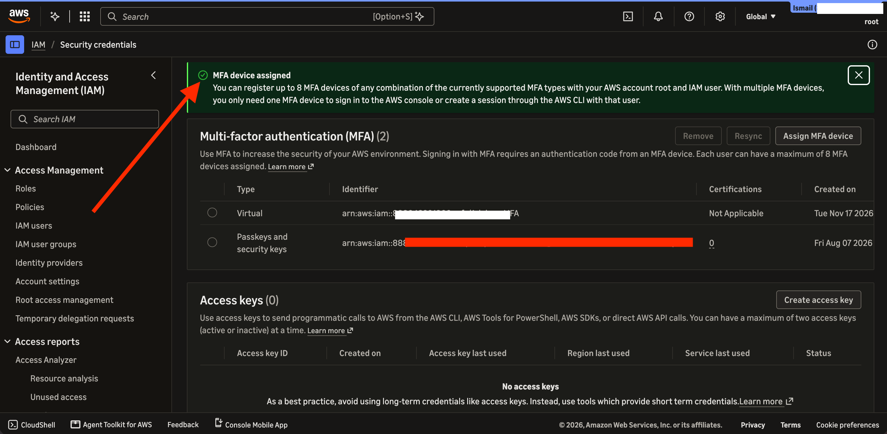
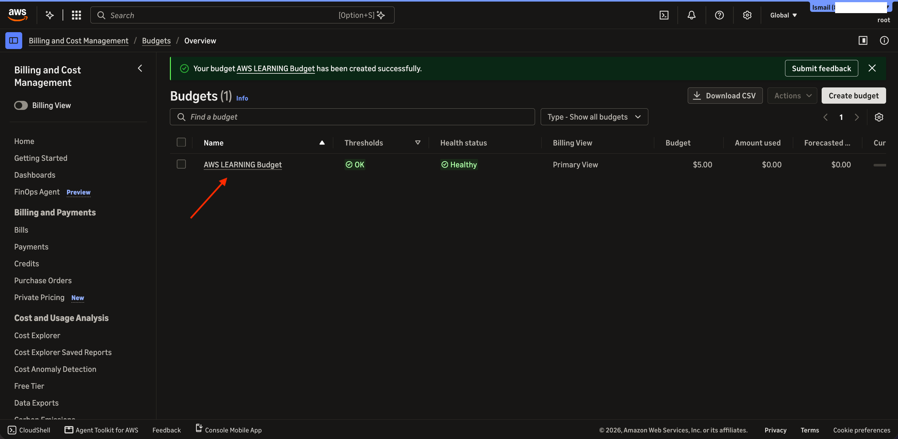

# AWS IAM and Least Privilege Project

## Phase 1: AWS Account Security

### Objective

Secure my AWS account before implementing IAM security controls.

### Security Controls Implemented

| Security Control | Status |
|---|---|
| AWS account access verified | Completed |
| Root account MFA | Completed |
| Monthly AWS budget | Completed |
| Billing notifications | Completed |

### Root Account MFA

Enabled Multi-Factor Authentication (MFA) on my AWS root account to provide an additional layer of protection against unauthorised access.

MFA requires an additional authentication factor alongside the account password, making it more difficult for unauthorised users to access the account.

### AWS Monthly Budget

Created a monthly AWS cost budget to monitor cloud expenditure and track spending against a defined budget limit.

Configured spending thresholds to help monitor actual and forecasted costs and identify unexpected increases in expenditure.

### Billing Notifications

Configured AWS billing notifications to receive alerts when cloud spending reaches specified thresholds.

These notifications help monitor AWS expenditure and provide early warnings of unexpected increases in cloud costs.

### Security Considerations

- Root account access should be restricted and used only when necessary.
- MFA should be enabled on privileged accounts.
- Billing notifications help identify unexpected expenditure.
- AWS Budget alerts do not automatically stop AWS services or prevent additional charges.
- AWS account spending should be monitored regularly.

### Evidence

**Root Account MFA**

**MFA Device Assigned**

**MFA Verification**

**AWS Monthly Budget**

**Billing Notifications**

### Lessons Learned

Through this phase, I learned how to secure an AWS root account using MFA, configure monthly AWS budgets and set up billing notifications.

I also learned the importance of protecting privileged accounts and monitoring cloud expenditure to help manage unexpected costs.

---

# Phase 2: AWS IAM Users, Groups and Least Privilege

## Objective

The objective of this phase is to understand how AWS Identity and Access Management (IAM) controls access to AWS resources through users, groups and policies.

I will implement IAM access controls using the principle of Least Privilege, ensuring that users receive only the permissions required to perform their assigned tasks.

## Implementation Plan

The following tasks will be completed during this phase:

1. Inspect existing IAM users and review their permissions.
2. Create dedicated IAM groups based on job responsibilities.
3. Create test IAM users.
4. Assign users to appropriate IAM groups.
5. Create and configure custom IAM policies.
6. Apply the principle of Least Privilege.
7. Test allowed and denied permissions.
8. Review IAM configurations for excessive permissions.

## Security Principles

- Least Privilege: Give users only the permissions they need.
- Group-Based Access Control: Manage permissions through IAM groups.
- Separation of Duties: Separate responsibilities between users.
- MFA Protection: Protect privileged identities using Multi-Factor Authentication.
- Permission Testing: Verify permitted and restricted access.

## Implementation Progress

| Task | Status |
|---|---|
| Inspect existing IAM users | Pending |
| Create IAM groups | Pending |
| Create test IAM users | Pending |
| Assign users to groups | Pending |
| Configure custom IAM policies | Pending |
| Apply least privilege | Pending |
| Test allowed and denied permissions | Pending |
| Review IAM security configuration | Pending |

## Evidence and Documentation

Screenshots and test results will be added as each task is completed.

Planned evidence:

- screenshots/iam-users.png
- screenshots/iam-groups.png
- screenshots/iam-user-group-assignment.png
- screenshots/iam-custom-policy.png
- screenshots/iam-permission-test.png

## Expected Learning Outcomes

By completing this phase, I expect to understand:

- How IAM users, groups and policies work together.
- How to create and manage IAM identities.
- How AWS evaluates permissions.
- How to implement least-privilege access.
- How to test and troubleshoot IAM permissions.

## Project Status

In Progress.
