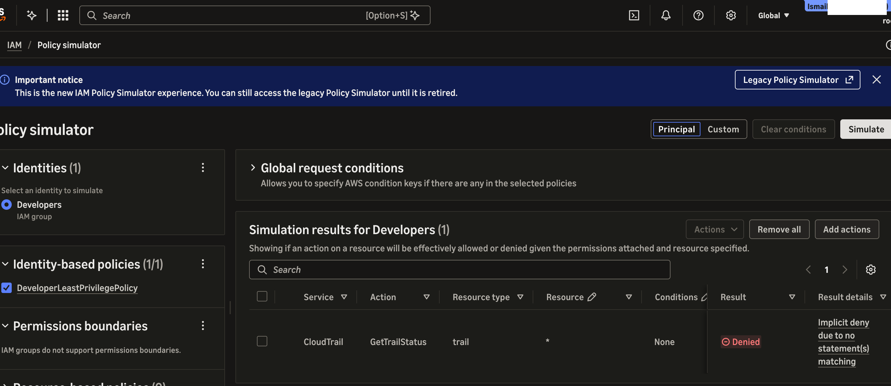

# AWS IAM and Least Privilege Project

## Phase 1: AWS Account Security

### Objective

Secure my AWS account before implementing IAM security controls.

### Security Controls Implemented

| Security Control | Status |
|---|---|
| AWS account access verified | Completed |
| Root account MFA | Completed |
| Monthly AWS budget | Completed |
| Billing notifications | Completed |

### Root Account MFA

Enabled Multi-Factor Authentication (MFA) on my AWS root account to provide an additional layer of protection against unauthorised access.

MFA requires an additional authentication factor alongside the account password, making it more difficult for unauthorised users to access the account.

### AWS Monthly Budget

Created a monthly AWS cost budget to monitor cloud expenditure and track spending against a defined budget limit.

Configured spending thresholds to help monitor actual and forecasted costs and identify unexpected increases in expenditure.

### Billing Notifications

Configured AWS billing notifications to receive alerts when cloud spending reaches specified thresholds.

These notifications help monitor AWS expenditure and provide early warnings of unexpected increases in cloud costs.

### Security Considerations

- Root account access should be restricted and used only when necessary.
- MFA should be enabled on privileged accounts.
- Billing notifications help identify unexpected expenditure.
- AWS Budget alerts do not automatically stop AWS services or prevent additional charges.
- AWS account spending should be monitored regularly.

### Evidence

**Root Account MFA**

**MFA Device Assigned**

**MFA Verification**

**AWS Monthly Budget**

**Billing Notifications**

### Lessons Learned

Through this phase, I learned how to secure an AWS root account using MFA, configure monthly AWS budgets and set up billing notifications.

I also learned the importance of protecting privileged accounts and monitoring cloud expenditure to help manage unexpected costs.

---
## Phase 2: AWS IAM Users and Groups Creation

### Objective

The aim of this phase was to create IAM users and groups in AWS and organise access based on different job roles.

### Step 1: Check Existing IAM Users and Groups

I first checked my AWS account to see whether any IAM users or groups already existed.

**Findings:**
- No existing IAM users were found.
- No existing IAM groups were found.

This gave me a clean starting point for creating my IAM environment.

**Evidence:**

### Step 2: Create IAM Groups

I created two IAM groups for different job roles.

| Group name | Purpose |
|---|---|
| Developers | For users carrying out development tasks. |
| SecurityAuditors | For users carrying out security auditing tasks. |

Creating groups makes it easier to manage permissions for different users.

**Evidence:**

## Phase 3: Custom IAM Policies and Permission Testing

### 3.6 Testing CloudTrail Permissions

In this step, I tested whether the Developers group could access CloudTrail information using the AWS IAM Policy Simulator.

The purpose of this test was to check whether the `DeveloperLeastPrivilegePolicy` allows or denies access to CloudTrail.

#### Step 1: Test the CloudTrail Permission

I selected the Developers group in the IAM Policy Simulator and tested the following action:

- **AWS Service:** CloudTrail
- **Action:** `GetTrailStatus`
- **Resource:** `*`

#### Step 2: Review the Simulation Result

The simulation returned a **Denied** result.

The permission was denied because no applicable policy statement granted access to the `cloudtrail:GetTrailStatus` action.

This shows that the Developers group does not have permission to check the status of CloudTrail trails.

#### Screenshot 6: CloudTrail Permission Test

The screenshot below shows the IAM Policy Simulator result for the CloudTrail permission test.

**Screenshot filename:** `CloudtrailGetStatus.png`

#### Result

The test confirmed that the Developers group cannot access the CloudTrail trail status using the current IAM policy.

This is an example of the principle of least privilege, where users are only given the permissions required for their work.

**Security finding:** The `DeveloperLeastPrivilegePolicy` does not grant CloudTrail trail-status access to the Developers group.
