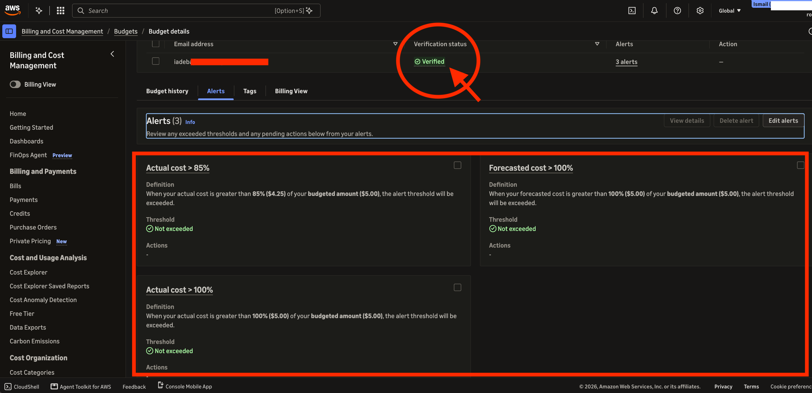

# AWS IAM and Least Privilege Project

## Phase 1: AWS Account Security

### Objective

Secure my AWS account before implementing IAM security controls.

### Security Controls Implemented

| Security Control | Status |
|---|---|
| AWS account access verified | Completed |
| Root account MFA | Completed |
| Monthly AWS budget | Completed |
| Billing notifications | Completed |

### Root Account MFA

Enabled Multi-Factor Authentication (MFA) on my AWS root account to provide an additional layer of protection against unauthorised access.

MFA requires an additional authentication factor alongside the account password, making it more difficult for unauthorised users to access the account.

### AWS Monthly Budget

Created a monthly AWS cost budget to monitor cloud expenditure and track spending against a defined budget limit.

Configured spending thresholds to help monitor actual and forecasted costs and identify unexpected increases in expenditure.

### Billing Notifications

Configured AWS billing notifications to receive alerts when cloud spending reaches specified thresholds.

These notifications help monitor AWS expenditure and provide early warnings of unexpected increases in cloud costs.

### Security Considerations

- Root account access should be restricted and used only when necessary.
- MFA should be enabled on privileged accounts.
- Billing notifications help identify unexpected expenditure.
- AWS Budget alerts do not automatically stop AWS services or prevent additional charges.
- AWS account spending should be monitored regularly.

### Evidence

**Root Account MFA**

**MFA Device Assigned**

**MFA Verification**

**AWS Monthly Budget**

**Billing Notifications**

### Lessons Learned

Through this phase, I learned how to secure an AWS root account using MFA, configure monthly AWS budgets and set up billing notifications.

I also learned the importance of protecting privileged accounts and monitoring cloud expenditure to help manage unexpected costs.

### Next Phase

**Phase 2: IAM Users, Groups and Least Privilege**

The next phase will focus on creating IAM users and groups, assigning permissions through IAM policies and applying the principle of Least Privilege.
