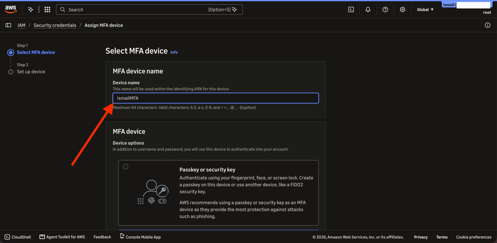
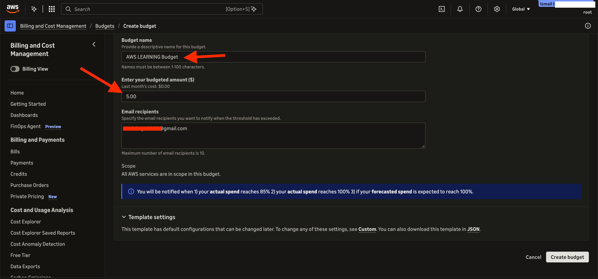
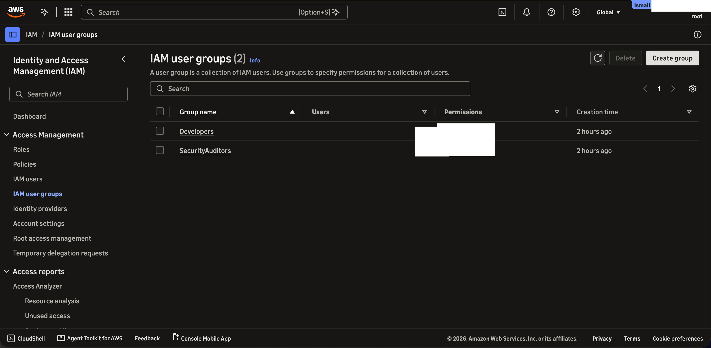
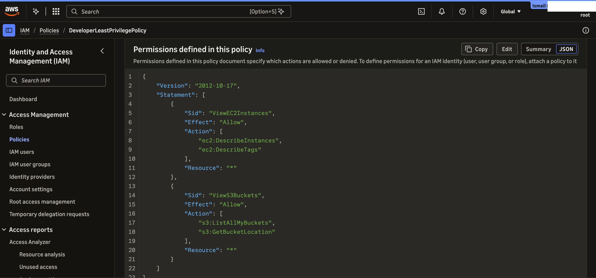
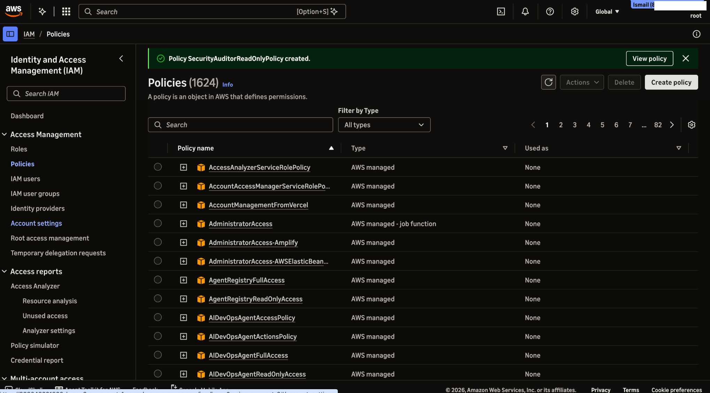
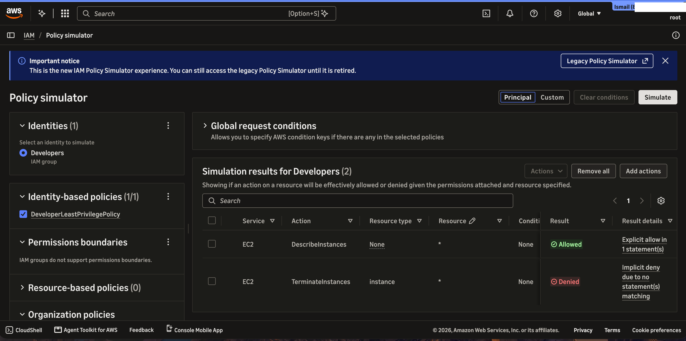
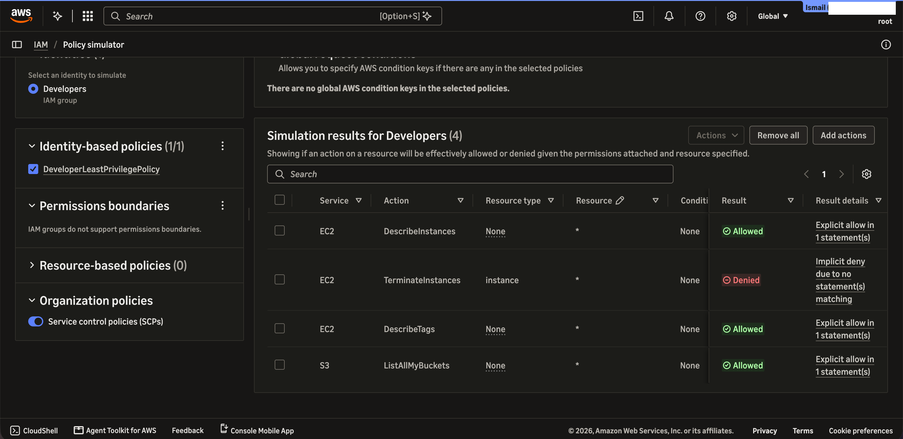
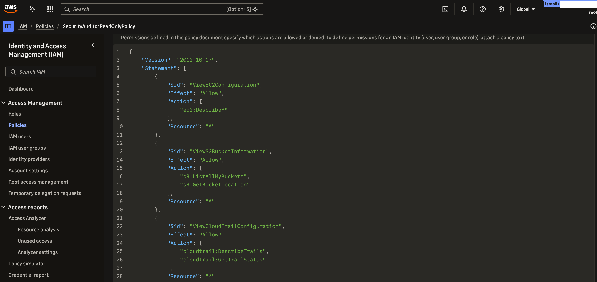
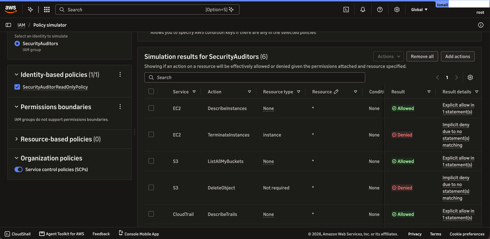

# AWS IAM and Least Privilege Project

## Phase 1: AWS Account Security

### Objective

Secure my AWS account before implementing IAM security controls.

### Security Controls Implemented

| Security Control | Status |
|---|---| 
| AWS account access verified | Completed |
| Root account MFA | Completed |
| Monthly AWS budget | Completed |
| Billing notifications | Completed |

### Root Account MFA

Enabled Multi-Factor Authentication (MFA) on my AWS root account to provide an additional layer of protection against unauthorised access.

MFA requires an additional authentication factor alongside the account password, making it more difficult for unauthorised users to access the account.

### AWS Monthly Budget

Created a monthly AWS cost budget to monitor cloud expenditure and track spending against a defined budget limit.

Configured spending thresholds to help monitor actual and forecasted costs and identify unexpected increases in expenditure.

### Billing Notifications

Configured AWS billing notifications to receive alerts when cloud spending reaches specified thresholds.

These notifications help monitor AWS expenditure and provide early warnings of unexpected increases in cloud costs.

### Security Considerations

- Root account access should be restricted and used only when necessary.
- MFA should be enabled on privileged accounts.
- Billing notifications help identify unexpected expenditure.
- AWS Budget alerts do not automatically stop AWS services or prevent additional charges.
- AWS account spending should be monitored regularly.

### Evidence

**Root Account MFA**

**MFA Device Assigned**

**MFA Verification**

**AWS Monthly Budget**

**Billing Notifications**

### Lessons Learned

Through this phase, I learned how to secure an AWS root account using MFA, configure monthly AWS budgets and set up billing notifications.

I also learned the importance of protecting privileged accounts and monitoring cloud expenditure to help manage unexpected costs.

---
## Phase 2: AWS IAM Users and Groups Creation

### Objective

The aim of this phase was to create IAM users and groups in AWS and organise access based on different job roles.

### Step 1: Check Existing IAM Users and Groups

I first checked my AWS account to see whether any IAM users or groups already existed.

**Findings:**
- No existing IAM users were found.
- No existing IAM groups were found.

This gave me a clean starting point for creating my IAM environment.

**Evidence:**

### Step 2: Create IAM Groups

I created two IAM groups for different job roles.

| Group name | Purpose |
|---|---|
| Developers | For users carrying out development tasks. |
| SecurityAuditors | For users carrying out security auditing tasks. |

Creating groups makes it easier to manage permissions for different users.

**Evidence:**

### Stage 4: Create Custom IAM Policies

## Project Objective

The objective of this phase was to understand and implement AWS Identity and Access Management (IAM) by creating IAM users and groups, assigning permissions through IAM policies, and applying the principle of least privilege.

I aimed to learn how to organise users based on their responsibilities, control access to AWS resources, and provide only the permissions required for each role.

Through this project, I gained practical experience in managing AWS identities, creating custom IAM policies, and understanding how permissions help protect cloud resources from unauthorised access.

### Step 4a: Review the Developer Least Privilege Policy

The DeveloperLeastPrivilegePolicy defines the permissions 
available to the Developers group.

The policy allows developers to view EC2 instance 
information, view EC2 tags, and list S3 buckets.

It does not grant permission to terminate EC2 instances, 
delete S3 objects, or access CloudTrail information.

This helps apply the principle of least privilege by 
allowing only the permissions required for development tasks.

**Developers policy**

**SecurityAuditors policy**

### Stage 5: Assign Permissions to IAM Groups
 
**Developers group**

I attached the custom `DeveloperLeastPrivilegePolicy` to the Developers group. This policy provides development-related permissions while following the principle of least privilege, helping to prevent unnecessary access to AWS resources.

**Test 1: EC2 DescribeInstances**

I used the AWS IAM Policy Simulator to test whether the Developers group could view EC2 instance information.

The simulation returned an **Allowed** result, confirming that the `DeveloperLeastPrivilegePolicy` grants permission to perform the `ec2:DescribeInstances` action.

**Test 2: EC2 TerminateInstances**

This test checks whether the Developers group can terminate EC2 instances. The policy simulator shows that the action is denied because the group does not have permission to terminate instances.

This confirms that the DeveloperLeastPrivilegePolicy allows users to view EC2 instance information while restricting actions that could affect running resources.

**Result:** Access denied, as expected.

**Test 3: EC2 DescribeTags**

This test checks whether the Developers group can view EC2 instance tags. The policy simulator shows that the action is allowed because the DeveloperLeastPrivilegePolicy grants permission to describe EC2 resources.

This confirms that developers can view EC2 resource information while being restricted from terminating instances.

**Result:** Access allowed, as expected.

**Test 4: S3 ListAllMyBuckets**

This test checks whether the Developers group can view a list of S3 buckets in the AWS account.

The policy simulator shows that the action is allowed because the DeveloperLeastPrivilegePolicy grants permission to list S3 buckets.

This confirms that developers can view the available S3 buckets without being granted full access to their contents.

**Result:** Access allowed, as expected.

**Test 5: Verify CloudTrail Access Restrictions** 

This test confirms that the Developers group is denied access to cloudtrail:GetTrailStatus. The permission is not included in the DeveloperLeastPrivilegePolicy, so the action is denied.

This demonstrates the principle of least privilege by preventing developers from accessing CloudTrail information they do not need.

### Test 6: Verify S3 DeleteObject Access Restrictions

This test checks whether the Developers group can delete objects stored in S3 buckets.

The policy simulator shows that the action is denied because the DeveloperLeastPrivilegePolicy does not grant permission to delete S3 objects.

This confirms that developers can view S3 bucket information without having permission to delete stored objects.

**Result:** Access denied, as expected.

The SecurityAuditorReadOnlyPolicy allows users to view EC2 configuration, S3 bucket information, and CloudTrail configuration.

The policy does not grant permission to modify or delete these resources.

This helps apply the principle of least privilege by providing read-only access for security auditing activities.

### Test 7: Verify CloudTrail Read-Only Access

This test checks whether the SecurityAuditors group can view AWS CloudTrail configuration.

The policy simulator shows that the cloudtrail:DescribeTrails action is allowed.

This confirms that the SecurityAuditors group can view CloudTrail information without having permission to modify or delete resources.

**Result:** Access allowed, as expected.

**SecurityAuditors group**
I attached the custom `SecurityAuditorReadOnlyPolicy` to the SecurityAuditors group. This policy allows members of the group to view selected AWS configuration information without granting unnecessary permissions to modify resources.

**Test 7: CloudTrail Read-Only Access**

This test confirms that the SecurityAuditors group can view AWS CloudTrail configuration without making changes.

The policy simulator shows that the `cloudtrail:DescribeTrails` action is allowed, demonstrating read-only access to CloudTrail information.

### Stage 7: Review the Final Policy Simulator Results

## Lessons Learned

During Phase 3, I learned how to manage AWS IAM permissions and apply the principle of least privilege.

- **IAM users and groups:** I learned how to organise users into groups and assign permissions based on their responsibilities.
- **Custom IAM policies:** I learned how to create custom policies that grant users access to specific AWS services.
- **Least privilege:** I learned why users should only receive the permissions they need to perform their tasks.
- **Testing permissions:** I learned how to check whether users can access the resources they are allowed to use and are denied access to restricted resources.
- **Security best practices:** I learned why it is important to avoid unnecessary administrative permissions and protect privileged accounts.

### Key Takeaway

I learned that AWS IAM is an important part of cloud security. Properly managing users, groups, and permissions helps reduce the risk of unauthorised access to AWS resources.
