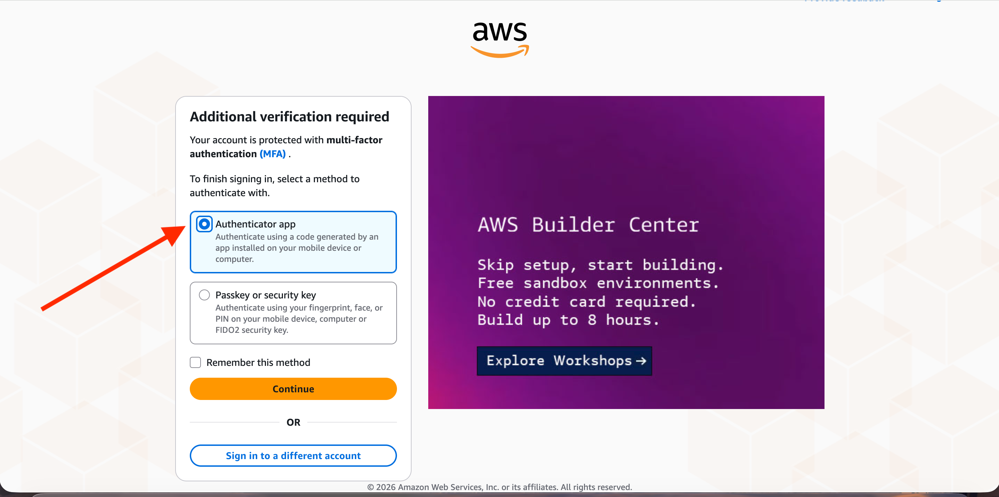
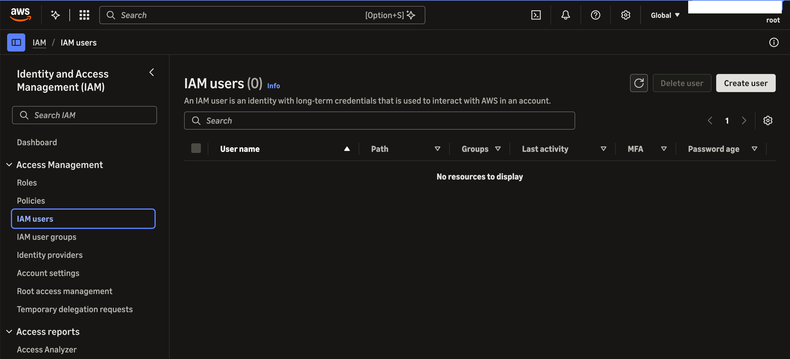
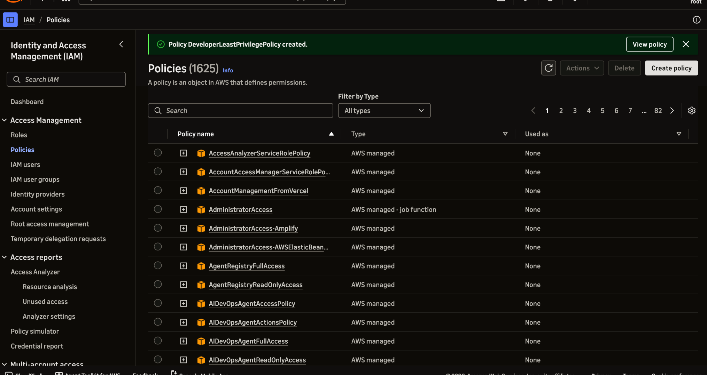
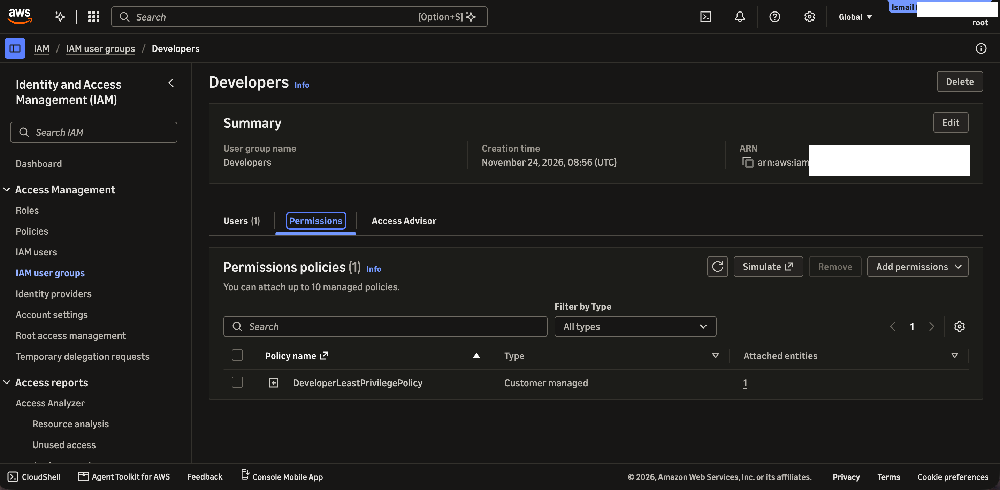
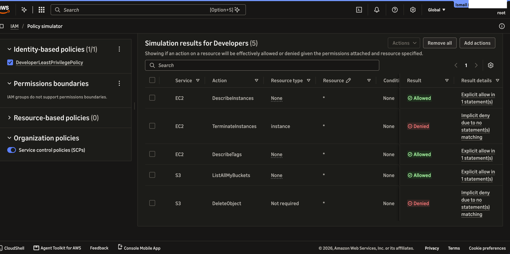
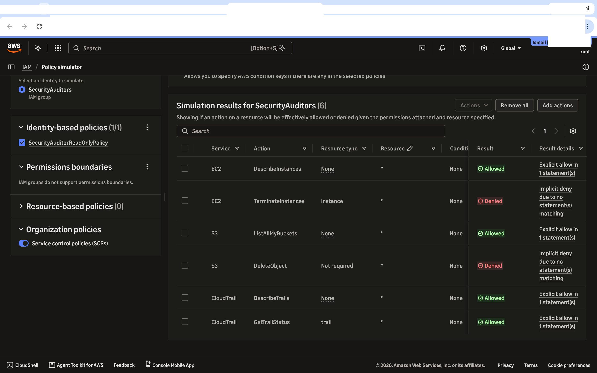

# AWS IAM and Least Privilege Project

## Phase 1: AWS Account Security

### Objective

Secure my AWS account before implementing IAM security controls.

### Security Controls Implemented

| Security Control | Status |
|---|---| 
| AWS account access verified | Completed |
| Root account MFA | Completed |
| Monthly AWS budget | Completed |
| Billing notifications | Completed |

### Root Account MFA

Enabled Multi-Factor Authentication (MFA) on my AWS root account to provide an additional layer of protection against unauthorised access.

MFA requires an additional authentication factor alongside the account password, making it more difficult for unauthorised users to access the account.

### AWS Monthly Budget

Created a monthly AWS cost budget to monitor cloud expenditure and track spending against a defined budget limit.

Configured spending thresholds to help monitor actual and forecasted costs and identify unexpected increases in expenditure.

### Billing Notifications

Configured AWS billing notifications to receive alerts when cloud spending reaches specified thresholds.

These notifications help monitor AWS expenditure and provide early warnings of unexpected increases in cloud costs.

### Security Considerations

- Root account access should be restricted and used only when necessary.
- MFA should be enabled on privileged accounts.
- Billing notifications help identify unexpected expenditure.
- AWS Budget alerts do not automatically stop AWS services or prevent additional charges.
- AWS account spending should be monitored regularly.

### Evidence

**Root Account MFA**

**MFA Device Assigned**

**MFA Verification**

**AWS Monthly Budget**

**Billing Notifications**

### Lessons Learned

Through this phase, I learned how to secure an AWS root account using MFA, configure monthly AWS budgets and set up billing notifications.

I also learned the importance of protecting privileged accounts and monitoring cloud expenditure to help manage unexpected costs.

---
## Phase 2: AWS IAM Users and Groups Creation

### Objective

The aim of this phase was to create IAM users and groups in AWS and organise access based on different job roles.

### Step 1: Check Existing IAM Users and Groups

I first checked my AWS account to see whether any IAM users or groups already existed.

**Findings:**
- No existing IAM users were found.
- No existing IAM groups were found.

This gave me a clean starting point for creating my IAM environment.

**Evidence:**

### Step 2: Create IAM Groups

I created two IAM groups for different job roles.

| Group name | Purpose |
|---|---|
| Developers | For users carrying out development tasks. |
| SecurityAuditors | For users carrying out security auditing tasks. |

Creating groups makes it easier to manage permissions for different users.

**Evidence:**

### Stage 4: Create Custom IAM Policies

**SecurityAuditors policy**

**Developers policy**

### Stage 5: Assign Permissions to IAM Groups

**SecurityAuditors group**

**Developers group**

### Stage 6: Test SecurityAuditors Permissions

**Test 1: EC2 DescribeInstances**

**Test 2: EC2 TerminateInstances**

**Test 3: EC2 DescribeTags**

**Test 4: S3 ListAllMyBuckets**

**Test 5: S3 DeleteObject**

**Test 6: CloudTrail Read-Only Access**

### Stage 7: Review the Final Policy Simulator Results

